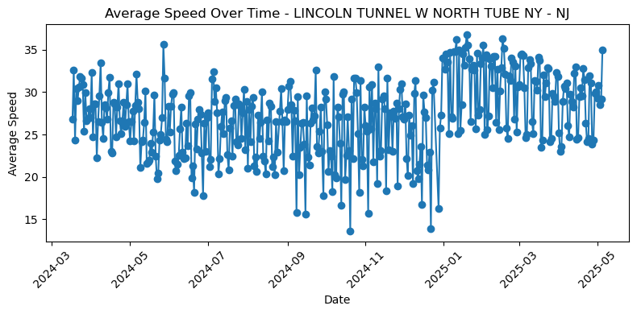
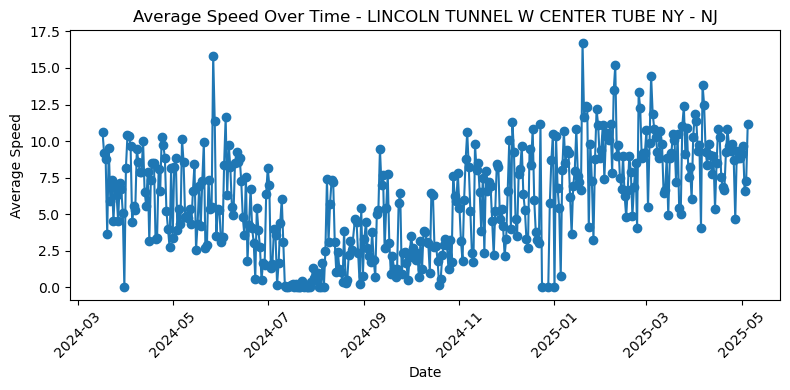
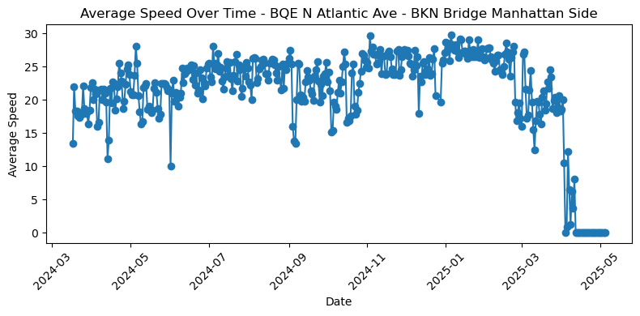

# NYC Congestion Pricing: What Changed on the Roads?

Team project for **AMS 561** at Stony Brook University (March–May 2025), by Jacky Jiang and Samuel Osei Poku.

On January 5, 2025, New York City began charging most vehicles that enter Manhattan below 60th Street. We combined MTA and NYC DOT data from March 2024 to May 2025 to see how road speeds, crossing volumes, and subway ridership changed around the launch.

## What we found

- **Lincoln Tunnel speeds rose after pricing began.** The westbound north tube went from mostly mid-20s mph to the low 30s.
- **Not every drop was traffic.** We concluded a broken tunnel sensor caused the stretch with no readings in the Lincoln Tunnel west center tube (summer 2024). BQE segments falling to 0 mph in April 2025 and an MDE/RFK segment reading 0 the whole period also point to sensor problems rather than real stoppages.
- We presented our findings with policy recommendations for urban transportation planning.



*Lincoln Tunnel westbound north tube (NY → NJ): speeds step up after congestion pricing began in January 2025.*



*Lincoln Tunnel westbound center tube: the stretch of zero readings in summer 2024 is the broken sensor, not stopped traffic.*



*BQE northbound, Atlantic Ave to Brooklyn Bridge (Manhattan side): readings fall to 0 mph in April 2025, another sign of a sensor problem.*

## Data

The notebook reads one Excel workbook, `AMS_561_Project.xlsx` (not included in this repo), with a sheet for each source:

| Sheet | Source | Used for |
| --- | --- | --- |
| `MTA_CRZV` | MTA congestion-zone vehicle entries | Daily entries by detection group |
| `MTA_BT` | MTA bridge and tunnel crossings | Daily E-ZPass + tolls-by-mail vehicles per toll plaza |
| `MTA_Rides_2024` | MTA daily ridership | Systemwide subway rides in 2024 |
| `MTA_Station_Rides_2025` | MTA subway ridership by station | 2025 ridership on selected lines |
| `Traffic_Speeds` | NYC DOT real-time traffic speeds | Speed and shape of each road segment |

## Methods

- **Cleaning and aggregating (pandas):** daily totals and averages by crossing, station, and road segment, including daily average speeds for 9 bridge-approach road segments.
- **Labeling:** mapped MTA plaza codes (`TBX`, `QMT`, `VNB`, …) to bridge and tunnel names; used a regular expression to pull subway lines out of station names.
- **Mapping (Folium):** parsed each segment's `lat,lon` point string into line geometry, built a GeoJSON time series, and made an interactive map with a day-by-day time slider, colored red (slow) to green (fast).
- **Charts (Matplotlib):** average daily speed over time for each road segment.

## Repository

| File | What it is |
| --- | --- |
| `AMS_561_Project.ipynb` | The analysis notebook, with a short explanation before each step |
| `images/` | Charts from the notebook used in this README |

The congestion-zone, bridge-and-tunnel, and subway sections are commented out in the current version of the notebook. The traffic-speed map and charts run as is.

## Running it

1. Install Python 3 and the libraries:
   ```
   pip install pandas matplotlib folium openpyxl
   ```
2. Put `AMS_561_Project.xlsx`, with the sheets listed above, next to the notebook.
3. Run the notebook in Jupyter. It draws a speed chart for each road segment and saves the interactive map as `nyc_speed_time_slider_map.html`, which you can open in a browser.

## Tools

Python · pandas · Matplotlib · Folium · Jupyter · Excel
